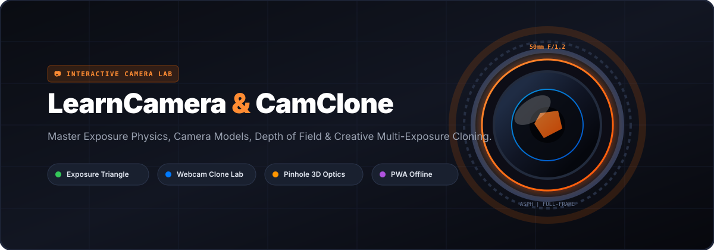
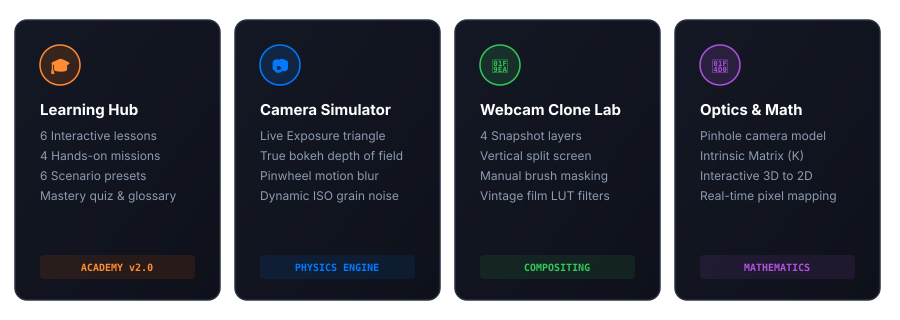

# 📷 CAM-CLONE-STUDIO (LearnCamera Academy)

<p align="center">
  
</p>

<p align="center">
  <a href="#-quick-start"></a>
  <a href="#-tech-stack"></a>
  <a href="#-license"></a>
  <a href="#-git-version-control"></a>
</p>

---

## 🌟 Overview

**CAM-CLONE-STUDIO** (incorporating **LearnCamera Academy**) is a high-performance, open-source web application engineered for photographers, creative technologists, and computer vision students.

It unifies **interactive photographic education**, **real-time camera physics simulation**, **creative multi-exposure clone compositing**, and **optical pinhole 3D-to-2D projection math** into a unified, zero-dependency suite.

<p align="center">
  
</p>

---

## 🚀 Key Modules & Capabilities

### 1. 🎓 Camera Academy & Learning Hub
A structured curriculum to help you master camera settings and optics through hands-on practice:
* **Interactive Lessons**:
  - **Lesson 01**: Aperture & Depth of Field (f-stops, bokeh, subject isolation).
  - **Lesson 02**: Shutter Speed & Motion Dynamics (action freeze vs motion blur).
  - **Lesson 03**: ISO Sensitivity & Sensor Signal-to-Noise Ratio (SNR).
  - **Lesson 04**: The Exposure Triangle & Reciprocal EV Compensation.
  - **Lesson 05**: Focal Lengths & Perspective Distortion (Wide vs Standard vs Telephoto).
  - **Lesson 06**: Digital Sensor Formats & Crop Factors (Full Frame, APS-C, Micro Four Thirds).
* **"Try in Simulator" Actions**: Instantly loads each lesson's parameters onto the live viewfinder.
* **Skill Challenges & Missions**: Hands-on assignments evaluated with real-time feedback:
  - 🏎️ *The Razor-Sharp Action Hero* (Freeze spinning motion at $\ge 1/500\text{s}$).
  - 👤 *The Dreamy Bokeh Portrait* (Shallow depth of field $\le f/2.0$ at close range).
  - 🌄 *The Deep Horizon Landscape* (Wide view $\le 35\text{mm}$, narrow aperture $\ge f/11$).
  - 🌌 *The Low-Light Night Stalker* (High ISO $\ge 1600$, balanced EV).
* **One-Click Genre Presets**: Instant recipes for *Creamy Portrait*, *Fast Sports*, *Night Astro*, *Street Documentary*, *Deep Landscape*, and *Motion Panning*.
* **Photography Mastery Quiz**: 5-question test with explanations and dynamic scoring.

---

### 2. 📷 Physical Camera Simulator

<p align="center">
  
</p>

A canvas-driven virtual camera rendering an animated, interactive 3D scene:
* **Exposure Triangle**:
  - **Aperture**: $f/1.2$, $f/1.8$, $f/2.8$, $f/4.0$, $f/5.6$, $f/8.0$, $f/11$, $f/16$, $f/22$.
  - **Shutter Speed**: $1/4000\text{s}$ down to $1\text{s}$.
  - **ISO**: $100$ to $12,800$.
* **Physics Engine**:
  - **Depth of Field (Bokeh)**: Dynamically calculated using Circle of Confusion (CoC) optics.
  - **Shutter Motion Blur**: Subdivided blade rendering across angular velocity steps.
  - **ISO Sensor Grain**: Real-time luminance/chrominance noise synthesis.
* **Viewfinder HUD & Controls**:
  - EV metering needle ($-3\text{ EV}$ to $+3\text{ EV}$) with overexposure/underexposure warning banners.
  - Rule-of-thirds compositional grid and focus target beeper.
  - Audio-synthesized shutter sound via Web Audio API.
  - Persistent **Camera Roll** film strip with direct JPEG export.

---

### 3. 🧪 Webcam Clone Lab
A multi-exposure compositor for creative clone photography:
* **Multi-Shot Capture**: Snap up to 4 layers using your webcam (or built-in holographic simulator fallback).
* **Blending Methods**:
  - **Split-Screen Mode**: Draggable vertical ratio division.
  - **Manual Brush Masking**: Adjustable brush size and softness to paint or erase clones into the base frame.
* **Vintage Film Profiles**: *Chrome Gold*, *Noir Mono*, *Cyberpunk Indigo*, and *Polaroid Faded*.
* **Export**: Instant master composite download.

---

### 4. 📐 Camera Optics & Math Visualizer

<p align="center">
  
</p>

Deep-dive into camera calibration and projective geometry:
* **The Pinhole Projection Equation**:
  $$u = f \cdot \frac{X}{Z} + u_0, \quad v = f \cdot \frac{Y}{Z} + v_0$$
* **Camera Intrinsic Calibration Matrix ($K$)**:
  $$\begin{bmatrix} u \\ v \\ 1 \end{bmatrix} = \begin{bmatrix} f_x & s & u_0 \\ 0 & f_y & v_0 \\ 0 & 0 & 1 \end{bmatrix} \begin{bmatrix} X \\ Y \\ Z \end{bmatrix}$$
* **Interactive 3D-to-2D Sandbox**: Adjust 3D coordinates $(X, Y, Z)$ and watch $(u, v)$ sensor pixel coordinates update in real time.

---

## ⚡ Quick Start

### 1. Clone the Repository
```bash
git clone https://github.com/lakshmikanth823/CAM-CLONE-STUDIO-.git
cd CAM-CLONE-STUDIO-
```

### 2. Run Locally
You can run it with any static web server:

**Using Python:**
```bash
python -m http.server 8000
```

**Using Node / npx:**
```bash
npx serve .
```

Open [http://localhost:8000](http://localhost:8000) in your browser.

---

## 📱 Progressive Web App (PWA)

This project is PWA-ready:
* Includes `manifest.json` and `sw.js` for full offline caching.
* Can be installed as a native desktop or mobile window directly from your browser's install icon.

---

## 📂 Project Architecture

```
CAM-CLONE-STUDIO-/
├── assets/                       # Vector diagrams, banners, and schematics
│   ├── banner.svg                # High-res application banner
│   ├── exposure-triangle.svg     # Exposure triangle educational graphic
│   ├── features-overview.svg     # 4-quadrant feature summary
│   └── pinhole-projection.svg    # Optical ray tracing diagram
├── index.html                    # Single-page application framework
├── style.css                     # Modern dark-carbon CSS design system
├── app.js                        # Simulation physics, Web Audio, PWA & Academy logic
├── manifest.json                 # PWA standalone manifest
├── sw.js                         # Service Worker offline cache
├── icon.svg                      # High-resolution vector camera icon
├── .gitignore                    # Git ignore file
└── README.md                     # Documentation & user guide
```

---

## 🤝 Contributing

Contributions, issues, and feature requests are welcome!
Feel free to open an issue or submit a pull request.

---

## 📄 License

This project is licensed under the [MIT License](LICENSE).
Built for interactive optics learning and creative photography.
